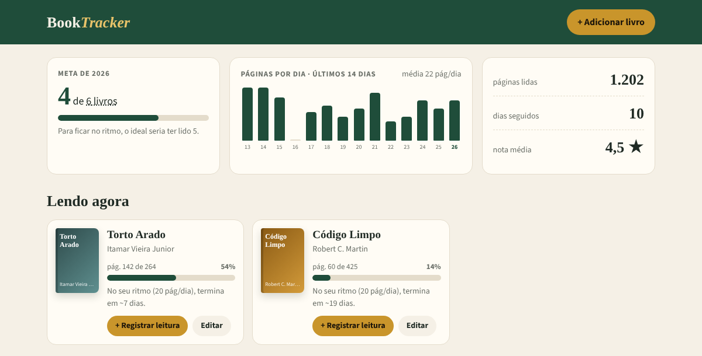

# BookTracker — Controle de leituras

Controle de leituras com estantes de lidos, lendo e quero ler, avaliação, resenha pessoal e páginas lidas por dia.

🔗 **[Ver o site no ar](https://iamviniciuslima05.github.io/PROJETO-BookTracker/)**



## Funcionalidades

- Estantes **Lendo agora, Lidos e Quero ler**
- **Avaliação** de 1 a 5 estrelas e **resenha pessoal**
- Registro de **páginas lidas por dia**
- **Gráfico** das páginas dos últimos 14 dias
- **Previsão de término** de cada livro no seu ritmo
- **Meta de livros do ano** editável
- Capas geradas automaticamente
- Busca e dias seguidos lendo

## Tecnologias

HTML5 · CSS3 · JavaScript · localStorage

## Estrutura

```
index.html
css/style.css
js/script.js
```

## Como rodar

Não precisa instalar nada: baixe o projeto e abra o `index.html` no navegador, ou acesse a versão publicada acima.

---
Feito por **Vinicius Lima** · [Portfólio](https://viniciuslimadev.netlify.app) · [LinkedIn](https://www.linkedin.com/in/viniciuslima25/)
